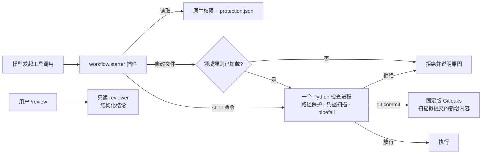

# OpenCode Workflow Starter

[](https://github.com/aether-dev365/opencode-workflow-starter/actions/workflows/ci.yml)

一套复制进项目即可使用的 OpenCode V2 工作流：一个本地插件 `workflow.starter`，加上领域规则、路径保护、提交前凭据扫描、手动审核和可选的受控发布。业务目录、框架、模型供应商和生产地址由目标项目自己配置。

**给接入模型的入口：[ADOPT.md](ADOPT.md)。** 可以直接告诉模型：

> 请阅读工作流套件的 ADOPT.md，根据本项目实际结构接入模板，保留现有约定，完成自检和验收，并报告未验证项。

## 解决什么问题

| 常见问题 | 本模板的做法 |
| --- | --- |
| 模型不看目录规范就改代码 | 首次修改某个领域前，先注入该领域的 `AGENTS.md`；未加载时拒绝修改，下一轮加载后重试 |
| 读到或改坏 `.env`、第三方代码、生成文件 | `protection.json` 声明读、写保护，插件在原生权限和 shell 解析两处检查 |
| 凭据被提交 | 每次 `git commit` 前用固定版本 Gitleaks 扫描新增内容；扫描器缺失、失败或超时都拒绝提交 |
| `npm test \| tail` 吞掉测试失败 | 测试类管道自动补 `pipefail`，失败退出码如实保留 |
| 审核随意、结论无结构 | 用户触发 `/review`，只读 reviewer 按检查单提交结构化结论 |
| 发布绕过审核 | 可选扩展：只有当前候选的审核全部通过，才运行登记好的固定发布命令 |

## 工作原理



守卫失败时一律拒绝（fail-closed）：检查脚本报错、超时、输出无效都按拒绝处理。插件和 shell 解析不是操作系统沙盒，外部终端和任意脚本不在拦截范围内。

## 平台支持

| 平台 | 状态 | 说明 |
| --- | --- | --- |
| Linux x64 | 已验收 | CI 全量验收，含 OpenCode 2.1.2 原生运行测试 |
| Windows + WSL2 | 已验收（同 Linux） | 推荐的 Windows 路线；所有命令在 WSL 终端里执行 |
| Windows 原生（Git Bash） | 部分验证 | 插件测试、守卫、doctor、接入脚本已在 Windows 实机通过，CI 运行 Windows 子集；OpenCode 原生加载插件尚未验收 |
| macOS（Apple Silicon） | 已验收 | CI 全量验收，含 OpenCode 2.1.2 原生运行测试；系统自带的 python3 是 3.9，需另装 3.10+ |
| macOS（Intel） | 未验收 | 扫描器已固定 x64 校验值，按同样步骤操作；接入后自行做原生冒烟 |

运行要求：Node.js 24+、Python 3.10+、Git（Windows 需完整的 Git for Windows，含 Git Bash）、OpenCode V2 CLI。OpenCode 与插件的验收基线均为 **2.1.2**。

## 快速开始

在目标项目根目录（独立的 Git 检出，没有就先 `git init`）复制 `template/` 的全部内容，包括隐藏文件，然后运行接入准备脚本。已有项目请让模型按 [ADOPT.md](ADOPT.md) 合并，避免覆盖现有配置。

### Linux、macOS、WSL

macOS 先安装前置工具（系统自带的 python3 是 3.9，不满足要求）：`brew install node python@3.12 git`。

```bash
git clone --depth 1 https://github.com/aether-dev365/opencode-workflow-starter.git /tmp/opencode-workflow-starter
cp -a /tmp/opencode-workflow-starter/template/. .
node scripts/workflow/setup.mjs
```

### Windows（PowerShell）

先安装前置工具（已有可跳过），装完重新打开终端：

```powershell
winget install --id OpenJS.NodeJS.LTS -e
winget install --id Python.Python.3.12 -e
winget install --id Git.Git -e
```

```powershell
git clone --depth 1 https://github.com/aether-dev365/opencode-workflow-starter.git $env:TEMP\opencode-workflow-starter
Copy-Item -Recurse -Force $env:TEMP\opencode-workflow-starter\template\* .
node scripts\workflow\setup.mjs
```

`setup.mjs` 会：检查 Node、Python、Git（Windows 上还检查 Git Bash）→ 安装插件依赖 → 安装固定版 Gitleaks → 检测 OpenCode → 运行 doctor。没有 OpenCode 时让你选择安装 CLI（经 npm 安装验收版本）或查看 Desktop 下载入口；非交互运行时用 `--opencode cli`、`--opencode desktop` 或 `--opencode skip`。已安装的 V1 或其他 V2 版本不会被替换，脚本只给出迁移或切换命令。

手动安装时依次运行（Windows 把 `python3` 换成 `py -3`）：

```bash
npm install -g @opencode/cli@2.1.2
npm --prefix .opencode/plugins/workflow ci --ignore-scripts
python3 .opencode/secret-scan/install.py
node scripts/workflow/doctor.mjs --root .
```

然后：

1. 在项目根目录启动 `opencode`，确认 `workflow.starter` 已加载且为 active。插件目录会被自动发现，**不要再在 plugins 配置里重复登记**。
2. 补充根 `AGENTS.md` 的项目概要和真实验证命令，按目录写领域规则，维护 `scopes.json`、`protection.json` 和审核路由。
3. 按 [安装指南](template/docs/workflow/opencode-install.md) 第 5 节做原生冒烟。doctor 的 `native-runtime: unverified` 是静态检查的边界，不代表插件已在原生环境通过。

doctor 对 2.1.2 报 pass，对其他 2.1.x 报 warn（需在该版本做原生冒烟并记录），其余版本报 fail。可用 `WORKFLOW_OPENCODE_BIN` 指定独立安装的 CLI，不必替换系统默认命令。

## 默认行为

- 日常修改由主代理完成；契约明确、文件范围独立时才委派实现者。
- 领域规则在压缩上下文和切换检出后重新确认。规则文件为空或超过 40000 个字符时不注入，并提示先修复它。
- 所有路径配置（保护、范围映射、审核路由、发布范围）使用同一套语义：`*` 匹配任意字符（含 `/` 和点开头的目录），`?` 匹配一个字符，其余按字面；不支持花括号。
- 暂存与提交分两次工具调用。普通提交不会自动派模型审核。
- reviewer 只读由插件强制：reviewer 会话只能读取、搜索和提交审核结论，与 reviewer.md 是否被加载无关。
- 看门狗只提醒，不自动中止或接管会话。
- 配置无效时插件仍为 active：拒绝写入并给出原因，读取和对 `.opencode/workflow/**`、`opencode.jsonc`、各目录 `AGENTS.md` 的修复编辑仍可用。`protection.json` 本身无效时所有读写都拒绝，需在 OpenCode 之外修复，例如 `git checkout -- .opencode/workflow/protection.json`。
- 不在 Git 检出内时读写和 shell 都会被拒绝，先 `git init`。
- `opencode.jsonc` 中 `"shell": "bash"`：守卫只解析 bash 语法。shell 为 PowerShell、cmd 或 WSL 启动器时，插件拒绝执行 shell 命令。

**没有必装的外部技能包。** OpenCode 内置技能、Superpowers 和 Anthropic 官方技能的来源和接入方式见 [技能依赖清单](docs/skills.md)。

## 目录

| 目录 | 用途 |
| --- | --- |
| [template/](template/) | 复制到目标项目的实际文件：插件、规则、守卫、接入脚本和文档 |
| [examples/](examples/) | 领域规则、任务卡、证据和接入报告范本 |
| [optional/release/](optional/release/) | 显式启用的发布审核和固定入口 |
| [optional/protection/](optional/protection/) | 私钥、SSH 密钥、云凭据等扩展保护规则 |
| [optional/production/](optional/production/) | 默认禁用的只读 MCP 配置示例 |
| [optional/stacks/](optional/stacks/) | 按技术栈核实命令的接入指引 |
| [scripts/](scripts/)、[tests/](tests/) | 套件自身的验证入口与测试，不复制到业务项目 |
| [OpenCode V2 安装指南](template/docs/workflow/opencode-install.md) | 官方安装来源、V1 迁移、Windows 两条路线和版本检查 |

## 常见问题

**PowerShell 里能直接用吗？** OpenCode 可以在 PowerShell 里启动，但它执行命令用的 shell 必须是 bash（`"shell": "bash"` 在 Windows 上解析为 Git Bash）。不要在 PowerShell 里运行 `bash ...`：那里的 `bash` 通常是 WSL 启动器，会在另一套文件系统里执行。

**PowerShell 提示 "禁止运行脚本"（npm.ps1）怎么办？** 改用 `npm.cmd`，或执行 `Set-ExecutionPolicy -Scope CurrentUser RemoteSigned` 后重开终端。

**提交被拦截说缺少 Gitleaks，可我刚装好？** OpenCode 后台服务的 PATH 在服务启动时就确定了。安装扫描器、插件依赖或修改 PATH 后执行 `opencode service restart`。

**doctor 报已跟踪文件命中凭据规则？** `*.env.*` 可能覆盖 `src/app.env.ts` 这类源码：确认是误伤就在 `protection.json` 末尾追加精确的 allow 规则；若确实是真实凭据，移出仓库并轮换。

**审核材料存放在哪里，怎么清理？** `/review` 导出的差异和证据在被忽略的 `.opencode/workflow/.state/review/material-*`，批次记录在 Git 目录下的 `workflow/reviews/batches/`（`git rev-parse --git-common-dir` 可查）。关闭批次不会删除材料。没有进行中的批次时可以删除材料目录：`rm -rf .opencode/workflow/.state/review/material-*`（PowerShell：`Remove-Item -Recurse -Force .opencode\workflow\.state\review\material-*`）。批次记录是审核结论的依据，使用发布扩展时不要删除。

**想保护私钥、SSH 密钥、云凭据？** 按 [optional/protection](optional/protection/README.md) 把扩展规则追加到 `protection.json`，再用 `node scripts/workflow/doctor.mjs --print-permissions` 生成新的原生权限块。

**会把我的代码发给第三方吗？** 插件和守卫只在本机运行。模型调用由你在 OpenCode 中配置的供应商处理；凭据扫描在本机进行，不上传任何内容。

## 发布与分发

正式版本见 [GitHub Releases](https://github.com/aether-dev365/opencode-workflow-starter/releases)，附分发包及其 SHA-256 文件；需要固定版本时也可以 `git clone --depth 1 --branch v1.0.0 …`。

维护者在套件根目录从已提交的版本生成干净分发包：

```bash
mkdir -p artifacts
git archive --format=tar.gz --output=artifacts/opencode-workflow-starter.tar.gz HEAD
sha256sum artifacts/opencode-workflow-starter.tar.gz > artifacts/opencode-workflow-starter.tar.gz.sha256
```

分发包只包含已提交的文件。依赖安装目录、缓存、验证产物、运行状态、本地凭据和个人工具配置都由 `.gitignore` 排除，分发测试会核对它们确实被忽略、交付文件没有被误忽略。变更记录见 [CHANGELOG.md](CHANGELOG.md)。

## 参与贡献

开发环境、验证命令（含 Windows 子集）和改动要求见 [CONTRIBUTING.md](CONTRIBUTING.md)，安全问题的报告方式见 [SECURITY.md](SECURITY.md)。

## 许可证

[MIT](LICENSE)。`template/` 复制进项目后可以自由修改和分发；其中的 `.opencode/LICENSE` 是版权声明，复制时一并保留即可。

## English summary

OpenCode Workflow Starter is a drop-in workflow for OpenCode V2 projects. A local plugin (`workflow.starter`) injects per-directory rules before the model edits a domain, enforces declarative read/edit protection for credentials, vendored and generated files, scans every `git commit` with a checksum-pinned Gitleaks, keeps test failures visible in pipelines, and provides a user-triggered, read-only `/review` with structured verdicts. Guards fail closed. Linux, WSL2 and macOS (Apple Silicon) are fully verified in CI, including native OpenCode 2.1.2 runs; native Windows (via Git Bash) passes the plugin, guard and adoption suites in CI and on real hardware, but native OpenCode on Windows is not yet accepted. Copy `template/` into your repository and run `node scripts/workflow/setup.mjs`. Licensed under MIT.
